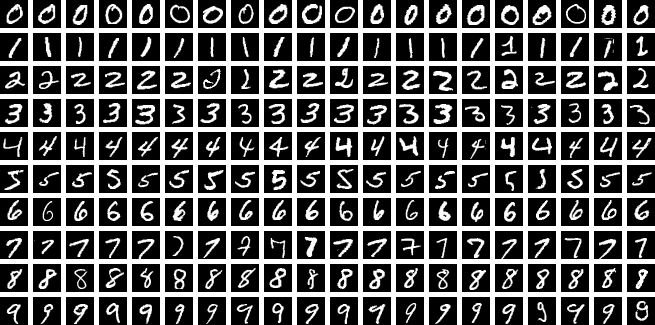
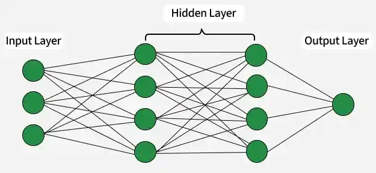

# Feedforward neural network

## MNIST database 
The MNIST database is a well known set of 60.000 handwritten numbers as training data and another 10.000 testing data. The numbers in the dataset looks something like this: 

A Feedforward neural network purpose is to learn the pattern of the given train data and try to recognize the learned patterns when seeing the test data.

## Converting pictures to input
To convert the 28x28 MNIST images to pixels i have reshaped each image into a 784-dimensional vector and convert pixel values from uint8 to float32 for numerical stability.

## Architecture
My code is implememted using numpy only so i can understand the different steps of maschine learning.
The neuronal network consists of one Input Layer, two Hidden Layers and an Output Layer.
The Input Layers only function is to read the dataset. Each neuron in the Input Layer represents a feature of the the input data.
Hidden Layers represent the learning function of a neuronal network and each neuron applies a weighted sum of inputs followed by a non-linear activation function. 
After the learning step is completed the now weighted neurons correspond to an final output

 
